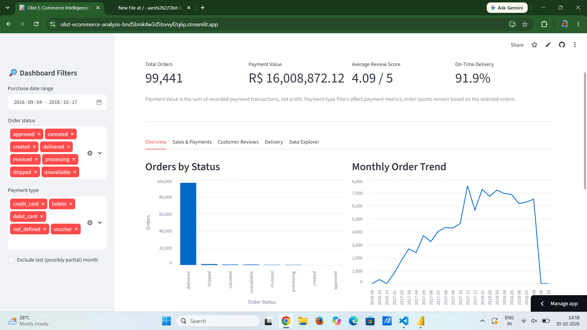
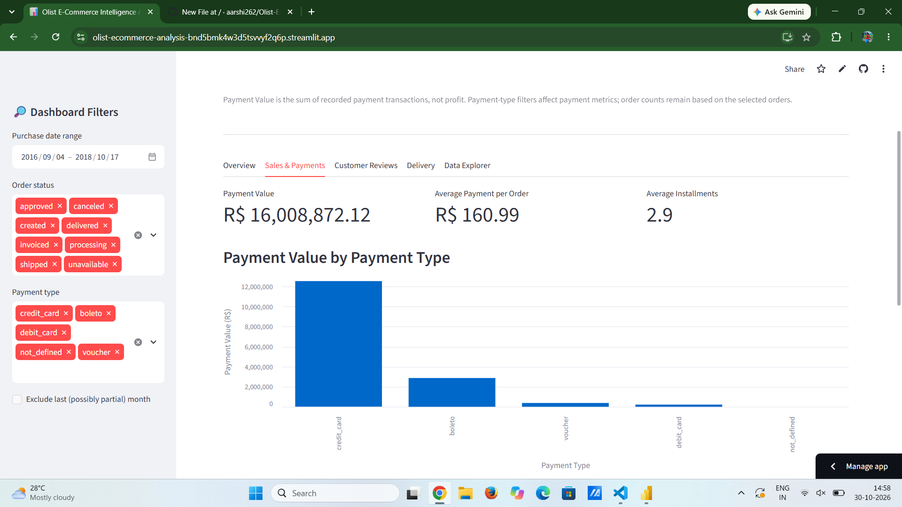
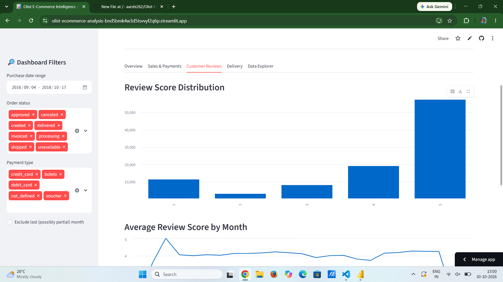
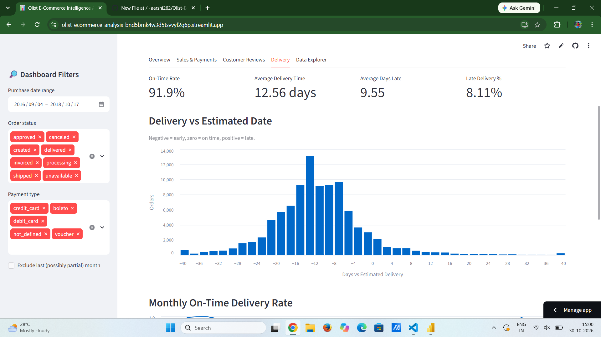

# Olist E-Commerce Intelligence Analyzer

An interactive e-commerce analytics web application built using Python, SQL, SQLite, Power BI, and Streamlit.

## Live Demo
[Open Live Dashboard](https://olist-ecommerce-analysis-bnd5bmk4w3d5tvswyf2q6p.streamlit.app/)

## Project Overview
This project analyzes the Brazilian E-Commerce Public Dataset by Olist to understand sales performance, customer reviews, payment behavior, and delivery performance.

The application provides interactive filters, visualizations, and data exploration features to support business decision-making.

## Key Features
- Business overview with key performance indicators
- Sales and payment analysis
- Payment type and installment analysis
- Customer review score distribution
- Monthly review trends
- Delivery performance and late delivery analysis
- Interactive filters for purchase dates, order status, and payment types
- Data exploration and CSV downloads

## Technologies Used
- Python
- SQL
- SQLite
- Pandas
- Streamlit
- Altair
- Power BI

## Key Metrics
- Total Orders: 99,441
- Average Delivery Time: 12.56 days
- On-Time Delivery Rate: 91.89%
- Late Delivery Rate: 8.11%
- Average Review Score: 4.09 / 5

## Dataset
Brazilian E-Commerce Public Dataset by Olist, available on Kaggle.

## Run Locally
1. Clone this repository.
2. Install dependencies using `pip install -r requirements.txt`.
3. Ensure the database file is extracted from `olist.zip` into the project directory.
4. Run `streamlit run app.py`.

## Dashboard Screenshots
### 1. Overview

### 2. Sales & Payments

### 3. Customer Reviews

### 4. Delivery Performance

## Author
Aarshi Singh
MSc Computer Science | Data Analytics Projects
